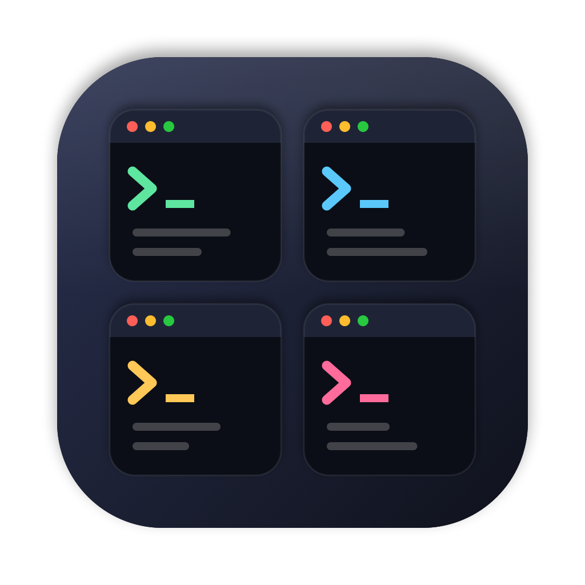

<p align="center"></p>

<h1 align="center">TermGrid</h1>

<p align="center">macOS 菜单栏小工具：把终端窗口"拖进去"，自动排成网格铺满屏幕，一眼看到所有终端在干什么。</p>

## 安装

1. 到 [Releases](../../releases/latest) 下载 `TermGrid-x.y.z.zip`，解压后把 `TermGrid.app` 拖进「应用程序」。
2. 这个 App 没有经过 Apple 公证，第一次打开会被拦下。在终端里执行一次：

   ```bash
   xattr -dr com.apple.quarantine /Applications/TermGrid.app
   ```

   或者先双击一次，再去「系统设置 → 隐私与安全性」底部点「仍要打开」。
3. 在「系统设置 → 隐私与安全性 → 辅助功能」里允许 TermGrid（移动其他 App 的窗口必须有这个权限）。

支持 macOS 13 及以上，Apple 芯片和 Intel 通用。

## 用法

- **拖进去**：拖动任意终端窗口，屏幕顶部会出现收纳区，拖到上面松手 → 加入排列，所有窗口自动重排、铺满屏幕。
- **拖出来**：把已排列的窗口再拖到收纳区 → 移出排列，恢复原来的位置和大小。
- **换位置**：把已排列的窗口拖到另一个窗口上 → 两者互换；拖到别处 → 弹回原格子。
- **多屏**：每块屏幕各自独立排列，拖到哪块屏幕的收纳区就排在哪块屏幕上。
- 关闭或最小化窗口会自动重排；退出 TermGrid 时所有窗口恢复原位。

| 快捷键 | 作用 |
| --- | --- |
| ⌃⌥F | 所有终端置前（最小化的也会恢复）|
| ⌃⌥G | 把所有打开的终端收纳到当前屏幕 |
| ⌃⌥T | 收纳 / 移出当前窗口 |
| ⌃⌥R | 重新排列 |

菜单栏里可以调整窗口间距、格子形状（偏高 / 均衡 / 偏宽），以及是否允许收纳非终端窗口。

支持的终端：Terminal、iTerm2、Ghostty、Warp、WezTerm、Alacritty、kitty、Hyper、Tabby、Rio、Wave。

## 从源码构建

只需要 Xcode Command Line Tools：

```bash
./build.sh                         # 生成 build/TermGrid.app
VERSION=0.2.0 ./build.sh --zip     # 同时打包 build/TermGrid-0.2.0.zip
scripts/make-icns.sh               # 修改 scripts/make-icon.swift 后重新生成图标
```

> 用的是 ad-hoc 签名，**每次重新编译后系统会认为是新 App**，需要在辅助功能列表里把旧的 TermGrid 删掉（−）再重新允许。

## 原理

macOS 不允许把别的 App 的窗口嵌进自己的窗口，所以 TermGrid 通过辅助功能 API 直接移动、缩放这些窗口：

- `DragWatcher` 监听全局鼠标事件，发现某个终端窗口在被拖动时显示收纳区；
- `TileManager` 按屏幕分组管理被收纳的窗口，关闭 / 最小化时自动重排；
- `GridLayout` 枚举行数，把窗口平均分到每一行，选"最挤的那一格"也最大的方案。

## License

MIT
